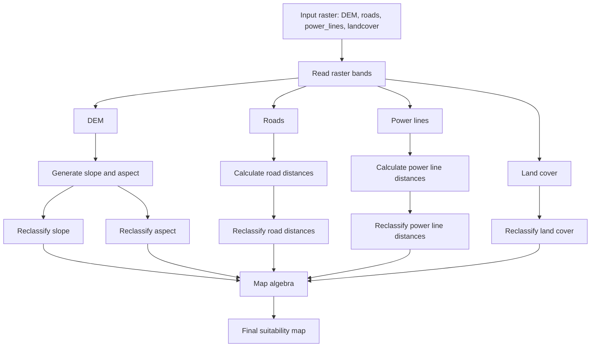

# Raster Analysis

> Symulacja wyboru lokalizacji dla inwestycji np farma fotowoltaiczna


## Workflow



---

# Odczyt rastra 

- otwórz zapisany raster, użyj funkcji z pakietu `dem_tools`
- rozpakuj tablicę do osobnych tablic: DEM, roads, pow_line, landcover
- ustaw odpwiedni typ danych dla każdego rastra: `float32`, `uint8`
- odczytaj i zapisz rozdzielczość: `dx`, `dy` [m/piksel]


---

# Rastry pochodne

Wygeneruj rastry: slope i azymut. Użyj funkcji z `dem_tools`.

*Uwaga*:
 - jeśli w twoim module nie ma odpowiednich funkcji - utwórz je
 - wzory znajdują się w ostatnim punkcie dokumentu


 ---

#  Slope, aspect - reklasyfikacja

Wykonaj analizę rastrową na `slope` i `asp` (aspect):
- używając ipywidgets dobierz wartość kryterium do reklasyfikacji
- utwórz rastry po reklasyfikacji: `slope_class` i `asp_class`

---


# roads, power_lines - mapy odległości

Wygeneruj nowe rastry:
- `roads_dist`, `power_lines_dist`
- każdy piksel zawiera odległość do najbliżeszej drogi / linii energetycznej

## Obliczanie odległości

- odlełość pomiędzy pikselami:
  $$ d = \sqrt{(row_1 - row_2)^2 + (col_1 - col_2)^2} $$
- odlełość pomiędzy pikselami w [m]:
  $$ d = \sqrt{((row_1 - row_2)\cdot dy)^2 + ((col_1 - col_2)\cdot dx)^2} $$
- zaimplementuj podstawowy algorytm oblicznia odległości dla każdego piksela
- schemat implementacji

```python
  def distance_to_nearest(ar, dx=1, dy=1):
      # wyznacz lokalizację obiektu (where())
      # wyznacz siatkę współrzędnych `np.indices()`

      # for loop:
      #   iteruj po lokalizacji i licz odległości 
      #   zapisz najmniejsze `np.minimum()`
      
```


## Reklasyfikacja

Interaktywnie ustal minimalną odległość od dróg i linii. Wykonaj reklasyfikację:
- roads_dist -> `roads_class`
- power_lines_dist -> `power_lines_class`

---


# Mapa pokrycia terenu - reklasyfikacja

Zdecyduj jakie tereny (pokrycia) przeznaczone zostaną pod inwestycję:
- wykonaj reklasyfikację rastra `landcover`:
  - `0` tereny nieprzydatne, `1` tereny przydatne
- utwórz nowy raster `landcover_class` - typ danych `uint8`

---


# Algebra rastrów (Map Algebra)

## Wstęp

>- **Algebra rastrów**: wykonywanie operacji matematycznych i logicznych na odpowiadających sobie pikselach różnych rastrów.
>- dla rastrów binarnych (`0`, `1`), gdzie `1` oznacza spełnienie warunku, można stosować:

| Operacja | NumPy | Znaczenie |
|---|---|---|
| Iloczyn logiczny (AND) | `a & b` | Oba warunki spełnione |
| Suma logiczna (OR) | `a \| b` | Co najmniej jeden warunek spełniony |
| Negacja (NOT) | `~a` | Odwrócenie warunku |
| Suma arytmetyczna | `a + b` | Liczba spełnionych warunków |

**Suma logiczna (OR) nie jest tym samym co suma arytmetyczna (+).**

| a | b | AND (`&`) | OR (`\|`) | Suma (`+`) |
|---|---|---|---|---|
| 0 | 0 | 0 | 0 | 0 |
| 0 | 1 | 0 | 1 | 1 |
| 1 | 0 | 0 | 1 | 1 |
| 1 | 1 | 1 | 1 | 2 |

Rastry muszą mieć identyczne wymiary i zgodne siatki przestrzenne.


**Uwaga:** negację `~` stosujemy tutaj do tablic logicznych `bool`. Dla `uint8` operator ten odwraca bity, więc `~0` nie daje `1`.


## Przykład

```python
a = np.array([
    [1, 0, 1],
    [0, 1, 1],
    [1, 0, 0]
], dtype=np.uint8)

b = np.array([
    [1, 1, 0],
    [0, 1, 0],
    [1, 1, 0]
], dtype=np.uint8)


a * b
a & b
a | b
a + b
```

## Analiza

Wykonaj i wyświetl wyniki operacji `or` i `and` dla wszytskich rastrów po reklasyfikacji.


---
---

# Wzory


## Gradient wysokości

- gradient – zmiana wysokości w kierunkach X i Y
- `np.gradient()` – pochodne obliczane numerycznie
- kolejność wyników dla rastra 2D: **wiersze, kolumny**


### 1. Gradient w kierunku Y (wiersze)

$$
g_y = \frac{z_{i+1,j} - z_{i-1,j}}{2\,dy}
$$

### 2. Gradient w kierunku X (kolumny)

$$
g_x = \frac{z_{i,j+1} - z_{i,j-1}}{2\,dx}
$$

gdzie:
  - $z_{i,j}$ — wysokość w pikselu o indeksach `(i, j)`,
  - $dx$ — wielkość piksela w kierunku kolumn,
  - $dy$ — wielkość piksela w kierunku wierszy.


```python
gy, gx = np.gradient(dem, dy, dx)
```

Funkcja do `dem_tools.py`:

```python
def dem_gradient(dem, dx, dy):
    pass
```


---


## Nachylenie terenu – slope

- oblicz nachylenie na podstawie składowych gradientu
- porównaj wartości w stopniach i procentach


### 1. Wielkość gradientu

$$
g = \sqrt{g_x^2 + g_y^2}
$$

```python
g = np.hypot(gx, gy)
```

### 2. Slope

$$
slope = \arctan(g) \cdot \frac{180}{\pi}
$$

```python
slope = np.degrees(np.arctan(g))
```

Wynik w stopniach, od 0° do 90°.


$$
\mathrm{slope}_{\%} = 100 \cdot g 
$$


- `np.hypot()`, `np.arctan()`, `np.degrees()`
- wyświetl mapę nachylenia i histogram
- wskaż obszary o największym nachyleniu

Funkcja do `dem_tools.py` (wynik w stopniach):

```python
def dem_slope(dem, dx, dy):
    pass
```

---


## Ekspozycja terenu – aspect

- aspect – azymut kierunku **największego spadku** terenu
- azymut: `0°` – N, `90°` – E, `180°` – S, `270°` – W
- `np.arctan2()` – wyznaczanie kąta z dwóch składowych gradientu


$$
aspect = \mathrm{atan2}(-g_x, g_y) \cdot \frac{180}{\pi}
$$

Normalizacja do zakresu 0–360°:

$$
aspect = (aspect + 360) \bmod 360
$$

```python
aspect = np.degrees(np.arctan2(-gx, gy))
aspect = (aspect + 360) % 360
```


> Na płaskim terenie (`g = 0`) ekspozycja jest niezdefiniowana.


Funkcja do `dem_tools.py` (wynik w stopniach):

```python
def dem_aspect(dem, dx, dy):
    pass
```

---

## Cieniowanie – hillshade

- symulacja oświetlenia powierzchni DEM
- `matplotlib.colors.LightSource`
- parametry: azymut i wysokość źródła światła
- wynik: raster intensywności oświetlenia w zakresie `0–1`

Funkcja do `dem_tools.py`:

```python
def dem_hillshade(dem, dx, dy, azimuth=315, altitude=45):
    pass
```

- porównaj oświetlenie z różnych kierunków: `315°`, `90°`, `180°`
- zmień wysokość źródła światła: `30°`, `60°`
- wyświetl DEM i hillshade obok siebie

---

## Warstwice – contours

- warstwice – linie jednakowej wysokości
- `plt.contour()` – rysowanie izolinii
- `levels` – poziomy wysokości warstwic
- `extent` i `origin="upper"` – zgodność z położeniem rastra

- narysuj warstwice co `10 m` i `20 m`
- dodaj etykiety wysokości (`clabel()`)
- nałóż warstwice na obraz DEM

> Na tym etapie wystarczy kod w notebooku; osobna funkcja nie jest konieczna.

---

